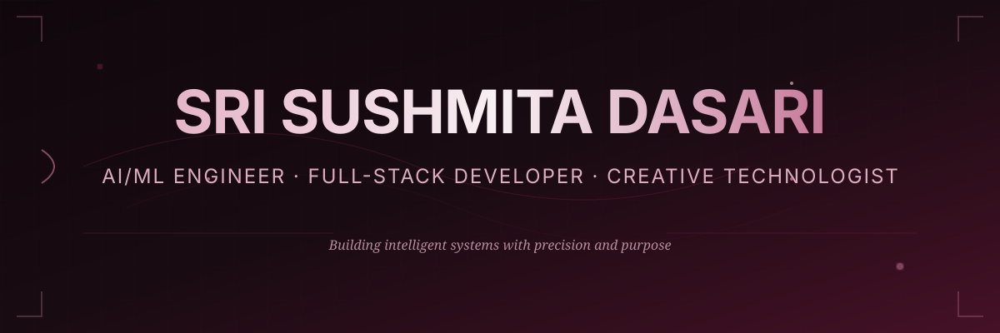

<!--
  SRI SUSHMITA DASARI — GITHUB PROFILE
  Design: BURGUNDY CINEMA (v1 · premium editorial)
  Theme: Midnight burgundy with animated SVG elements
  Repository: [username]/[username]
  
  SETUP INSTRUCTIONS:
  1. Replace [username] with your GitHub username throughout this file
  2. Replace [email] with your email address
  3. Replace [portfolio-url] with your portfolio website
  4. Add your actual project links in the Featured Projects section
  5. Add your coding profile links (LeetCode, CodeChef, etc.)
  6. Update LinkedIn URL if different from the placeholder
-->

  

## 👋 Hello, I'm Sushmita

I'm an **AI/ML Engineer**, **Full-Stack Developer**, and **Creative Technologist** passionate about building intelligent systems that solve real-world problems. My work combines machine learning innovation with production-ready software engineering.

I believe in **precision over perfection**, **purpose over features**, and **impact over complexity**.

 

---

## 🎓 Education

<table>
<tr>
<td width="50%" valign="top">

**B.Tech in Artificial Intelligence and Machine Learning**  
📍 Aditya Engineering College  
🎯 CGPA: **9.10** / 10.0

</td>
<td width="50%" valign="top">

**Specializations**
- Deep Learning & Neural Networks
- Machine Learning Systems
- Computer Vision & NLP
- Software Engineering

</td>
</tr>
</table>

 

---

## 🏆 Achievements & Recognition

| Achievement | Description | Year |
|------------|-------------|------|
| 🥈 **Flipkart GRiD 7.0** | National Semi-Finalist — India's premier engineering challenge | 2024 |
| 💜 **Myntra WeForShe HackerRamp** | Top 100 Teams — Innovation in technology | 2026 |

 

---

## 📜 Certifications

*Coming soon — Add your verified certifications here*

 

---

## 💼 Featured Projects

> Replace these descriptions with your actual projects and add repository/demo links

<table>
<tr>
<td width="50%" valign="top">

### 🤖 Machine Learning Projects

**[Project Name 1](#)** — Brief description  
*Tech Stack: PyTorch, FastAPI, Docker*

**[Project Name 2](#)** — Brief description  
*Tech Stack: TensorFlow, Keras, OpenCV*

**[Project Name 3](#)** — Brief description  
*Tech Stack: scikit-learn, Pandas, NumPy*

</td>
<td width="50%" valign="top">

### 🌐 Full-Stack Applications

**[Application Name 1](#)** — Brief description  
*Tech Stack: React, Node.js, MongoDB*

**[Application Name 2](#)** — Brief description  
*Tech Stack: Next.js, Django, PostgreSQL*

**[Application Name 3](#)** — Brief description  
*Tech Stack: TypeScript, FastAPI, Redis*

</td>
</tr>
<tr>
<td width="50%" valign="top">

### 🎨 Creative Technology

**[Creative Project 1](#)** — Brief description  
*Tech Stack: Three.js, WebGL, D3.js*

**[Creative Project 2](#)** — Brief description  
*Tech Stack: SVG Animation, GSAP, Canvas*

</td>
<td width="50%" valign="top">

### 📊 Data Science & Analytics

**[Analysis Project 1](#)** — Brief description  
*Tech Stack: Pandas, Matplotlib, Seaborn*

**[Analysis Project 2](#)** — Brief description  
*Tech Stack: NumPy, SciPy, Jupyter*

</td>
</tr>
</table>

 
<a href="https://github.com/[username]?tab=repositories"><b>→ View All Repositories</b></a>
  

---

## 🛠️ Technical Stack

### Languages & Frameworks

### AI & Machine Learning

### Web Development

### Tools & Platforms

### Databases

 

---

## 📈 GitHub Activity

<picture>
  <source media="(prefers-color-scheme: dark)" srcset="https://github-readme-stats.vercel.app/api?username=[username]&show_icons=true&hide_border=true&bg_color=10070C&title_color=E5B5C7&text_color=C77B9B&icon_color=701A3D&ring_color=C77B9B&rank_icon=github"/>
  
</picture>
&nbsp;&nbsp;
<picture>
  <source media="(prefers-color-scheme: dark)" srcset="https://github-readme-stats.vercel.app/api/top-langs/?username=[username]&layout=compact&hide_border=true&bg_color=10070C&title_color=E5B5C7&text_color=C77B9B&langs_count=8"/>
  
</picture>

  

<picture>
  <source media="(prefers-color-scheme: dark)" srcset="https://streak-stats.demolab.com?user=[username]&hide_border=true&background=10070C&ring=C77B9B&fire=E5B5C7&currStreakLabel=E5B5C7&sideLabels=C77B9B&currStreakNum=F8F0F3&sideNums=F8F0F3&dates=701A3D"/>
  
</picture>

  

<picture>
  <source media="(prefers-color-scheme: dark)" srcset="https://github-readme-activity-graph.vercel.app/graph?username=[username]&bg_color=10070C&color=E5B5C7&line=C77B9B&point=F8F0F3&area=true&area_color=701A3D&hide_border=true"/>
  
</picture>

 

---

## 🎯 Core Principles

| **LEARN** | **BUILD** | **ITERATE** | **SHARE** | **IMPACT** |
|:---------:|:---------:|:-----------:|:---------:|:----------:|
| Master fundamentals and emerging technologies | Create solutions that matter | Improve through feedback and testing | Contribute to open source | Measure real-world results |

 

---

## 🌐 Let's Connect

I'm always interested in collaborating on innovative projects, discussing AI/ML challenges,  
or exploring new opportunities in technology and creative development.

 

&nbsp;

&nbsp;

  

### 💻 Coding Profiles

  

 

✨ Crafted with care · Updated regularly · Open for collaboration ✨

