<!--
  CH SRIKAR — GITHUB PROFILE
  Design: OBSIDIAN // AURORA  (v4 · editorial)
  Repository: chsrikar/chsrikar
  Layout:  README.md  +  assets/  (hero, section headers, footer — self-hosted SVG, light/dark aware)
-->

 

<a href="https://github.com/chsrikar"><b>GITHUB</b></a> &nbsp;·&nbsp;
<a href="https://www.linkedin.com/in/chinthapenta-srikar-0497a2311"><b>LINKEDIN</b></a> &nbsp;·&nbsp;
<a href="mailto:srikarch248@gmail.com"><b>EMAIL</b></a>

  

<i>I build intelligent systems and study how to make them efficient — from the model itself to everything that surrounds it.</i>

 

<picture>
  <source media="(prefers-color-scheme: dark)" srcset="assets/h-identity-dark.svg">
  
</picture>

I'm a fourth-year B.Tech student in **AI & ML**, and a student of the **IIT Madras B.S. in Data Science and Applications**.

My work sits at the intersection of intelligent computation, scientific machine learning, and software systems. I'm drawn to a simple question: *how do models stay efficient, adaptive, and practical under real-world constraints?*

A model is never an isolated artifact. I explore the whole system around it — **architecture, inference, optimization, evaluation, deployment** — and try to measure before I claim.

 

<picture>
  <source media="(prefers-color-scheme: dark)" srcset="assets/h-research-dark.svg">
  
</picture>

<table>
<tr>
<td width="50%" valign="top">

**Adaptive Edge Intelligence** 
EFFICIENT LLM SYSTEMS

Resource-aware inference for language models on constrained hardware: adaptive runtime scheduling, CPU, memory and thermal telemetry, mixed-precision strategies, and explicit latency–quality–resource trade-offs.

`LLMs` · `Edge AI` · `Inference`

</td>
<td width="50%" valign="top">

**PRANA-G** 
PHYSICS-INFORMED MACHINE LEARNING

PINNs and neural surrogate models for scientific prediction. Physics-guided learning, computational efficiency, and careful evaluation and optimization.

`PINNs` · `DeepXDE` · `Scientific ML`

</td>
</tr>
<tr>
<td width="50%" valign="top">

**TRUEFRAME** 
SYNTHETIC MEDIA INTELLIGENCE

Multimodal, explainable detection of synthetic and manipulated imagery, combining deep visual representations, image-forensics signals and frequency-domain analysis into a trust assessment.

`Computer Vision` · `EfficientNet` · `Forensics`

</td>
<td width="50%" valign="top">

**Rakshak Credit** 
APPLIED PREDICTIVE INTELLIGENCE

Credit assessment from structured borrower and cash-flow data: feature engineering, predictive modeling, evaluation, and the application architecture around it.

`Python` · `LightGBM` · `FastAPI`

</td>
</tr>
<tr>
<td width="50%" valign="top">

**AIRCONTROL** 
TOUCHLESS HUMAN–COMPUTER INTERACTION

Vision-based hand and finger gesture control: operating a computer without touching it.

`OpenCV` · `HCI` · `Gesture Control`

</td>
<td width="50%" valign="top">

**Sign Language AI** 
AI FOR ACCESSIBILITY

Computer-vision approaches to sign recognition and accessible, two-way communication.

`CNN` · `TensorFlow` · `Keras`

</td>
</tr>
</table>

<b>ALSO</b> &nbsp;·&nbsp; <b>ATHENA</b> — predictive analytics and timetable recommendations through ML and simulation &nbsp;(<code>Regression</code> · <code>Monte Carlo</code>)

 

<a href="https://github.com/chsrikar?tab=repositories"><b>EXPLORE ALL REPOSITORIES →</b></a>

 

<picture>
  <source media="(prefers-color-scheme: dark)" srcset="assets/h-leadership-dark.svg">
  
</picture>

<table>
<tr>
<td width="33%" valign="top" align="center">

CEO 
**IEDC VISAT** 
Innovation, hackathons and student startups

</td>
<td width="33%" valign="top" align="center">

VICE CHAIR 
**MuLearn VISAT** 
Peer learning and open-source culture

</td>
<td width="33%" valign="top" align="center">

PINN DEVELOPER 
**Mekozza · PRANA-G** 
Physics-informed ML, roadmap and research

</td>
</tr>
</table>

 

<picture>
  <source media="(prefers-color-scheme: dark)" srcset="assets/h-stack-dark.svg">
  
</picture>

<b>LANGUAGES</b> 
<picture>
  <source media="(prefers-color-scheme: dark)" srcset="https://skillicons.dev/icons?i=python,cpp,c,js&theme=dark">
  
</picture>

 

<b>MACHINE LEARNING & SCIENTIFIC COMPUTING</b> 
<picture>
  <source media="(prefers-color-scheme: dark)" srcset="https://skillicons.dev/icons?i=pytorch,tensorflow,opencv&theme=dark">
  
</picture>

 

<b>SYSTEMS & INFRASTRUCTURE</b> 
<picture>
  <source media="(prefers-color-scheme: dark)" srcset="https://skillicons.dev/icons?i=linux,arch,docker,bash,git,github&theme=dark">
  
</picture>

 

<b>APPLICATION ENGINEERING</b> 
<picture>
  <source media="(prefers-color-scheme: dark)" srcset="https://skillicons.dev/icons?i=react,vite,fastapi,django,nodejs&theme=dark">
  
</picture>

 

<picture>
  <source media="(prefers-color-scheme: dark)" srcset="assets/h-activity-dark.svg">
  
</picture>

<picture>
  <source media="(prefers-color-scheme: dark)" srcset="https://github-readme-stats.vercel.app/api?username=chsrikar&show_icons=true&hide_border=true&bg_color=00000000&title_color=A5B4FC&text_color=C9D1D9&icon_color=22D3EE&ring_color=818CF8&rank_icon=github">
  
</picture>
&nbsp;&nbsp;
<picture>
  <source media="(prefers-color-scheme: dark)" srcset="https://github-readme-stats.vercel.app/api/top-langs/?username=chsrikar&layout=donut-vertical&hide_border=true&bg_color=00000000&title_color=A5B4FC&text_color=C9D1D9&langs_count=6">
  
</picture>

  

<picture>
  <source media="(prefers-color-scheme: dark)" srcset="https://streak-stats.demolab.com?user=chsrikar&hide_border=true&background=00000000&ring=818CF8&fire=22D3EE&currStreakLabel=A5B4FC&sideLabels=94A3B8&currStreakNum=E8ECFF&sideNums=E8ECFF&dates=64748B">
  
</picture>

  

<picture>
  <source media="(prefers-color-scheme: dark)" srcset="https://github-readme-activity-graph.vercel.app/graph?username=chsrikar&bg_color=0D1117&color=A5B4FC&line=22D3EE&point=F0ABFC&area=true&area_color=4F46E5&hide_border=true">
  
</picture>

 

<picture>
  <source media="(prefers-color-scheme: dark)" srcset="assets/h-principles-dark.svg">
  
</picture>

<table>
<tr>
<td width="20%" valign="top" align="center"><b>01</b> UNDERSTAND  <i>First principles before implementation.</i></td>
<td width="20%" valign="top" align="center"><b>02</b> DESIGN  <i>Architecture before complexity.</i></td>
<td width="20%" valign="top" align="center"><b>03</b> EXPERIMENT  <i>Evidence before conclusions.</i></td>
<td width="20%" valign="top" align="center"><b>04</b> OPTIMIZE  <i>Performance without losing quality.</i></td>
<td width="20%" valign="top" align="center"><b>05</b> BUILD FOR REALITY  <i>Constraints are requirements.</i></td>
</tr>
</table>

 

*The next frontier is not simply making AI larger.* 
*It is making intelligence more adaptive, efficient, and accessible.*

 

<picture>
  <source media="(prefers-color-scheme: dark)" srcset="assets/h-contact-dark.svg">
  
</picture>

Open to research collaborations, hard engineering problems, and open-source AI systems.

 

<a href="https://www.linkedin.com/in/chinthapenta-srikar-0497a2311"><b>LINKEDIN</b></a> &nbsp;·&nbsp;
<a href="mailto:srikarch248@gmail.com"><b>EMAIL</b></a> &nbsp;·&nbsp;
<a href="https://github.com/chsrikar"><b>GITHUB</b></a>

 

<picture>
  <source media="(prefers-color-scheme: dark)" srcset="assets/footer-dark.svg">
  
</picture>

